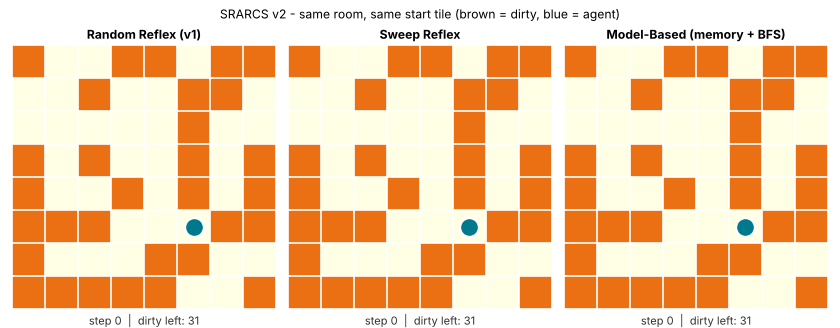
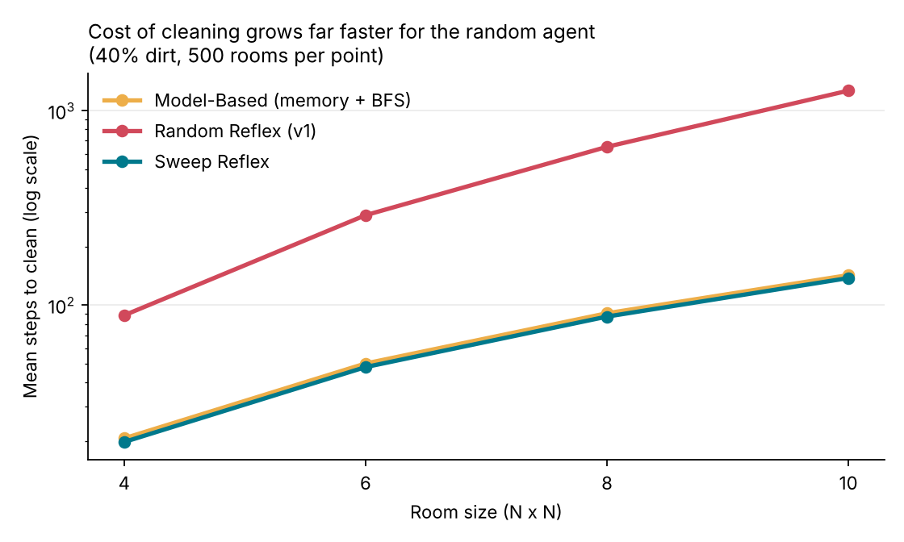

# SRARCS: Simple Reflex Agent Room Cleaning System

A grid-world simulation that started as a university AI lab project and grew into a small, reproducible study of **how much a cleaning agent's decision rule matters**.



*Same 8x8 room, same start tile. Left: the original random reflex agent. Middle: a reflex agent with a position-based sweep rule. Right: a model-based agent with memory.*

## Key findings

All numbers come from `run_experiments.py` (500 random rooms per configuration, identical rooms for every agent).

| Finding | Result |
|---|---|
| The original v1 setup (5x5, 40% dirt, random moves, **50-step cap**) fully cleans the room in only | **1.2%** of 5,000 runs (average room cleaned: 83.4%) |
| 8x8 room, 40% dirt: mean steps to finish | Random reflex **651**, sweep reflex **87**, model-based **91** |
| Gap at 10x10 | Random agent needs **~9x** more steps than the sweep agent |
| Random agent wasted moves | Bumps into walls ~120 times per 10x10 episode; the other two never do |
| Does memory beat a good reflex rule? | **No.** The memory-based agent is ~4% slower than the memory-less sweep. A smart *rule* captured nearly all the gain. |



The last finding is the interesting one: a reflex agent with no memory but a position-aware rule matches an agent that plans with an internal map. Agent *architecture* only pays off when the rule cannot be pre-computed (e.g. obstacles, unknown layouts), which is the natural next step for this project.

## The three agents

| Agent | Type | Rule |
|---|---|---|
| `RandomReflexAgent` | Simple reflex (original v1) | dirty -> clean, else move in a random direction |
| `SweepReflexAgent` | Simple reflex, position-aware | dirty -> clean, else follow a fixed closed loop that visits every tile (needs even grid size) |
| `ModelBasedAgent` | Model-based | remembers visited tiles, walks the shortest path (BFS) to the nearest unvisited one |

Every action, including bumping into a wall, costs one step, exactly as in v1.

## Quickstart

```bash
git clone https://github.com/ibramhaq/SRARCS-by-Ibram.git
cd SRARCS-by-Ibram
pip install -r requirements.txt

python run_experiments.py    # regenerates results/*.csv and results/*.png
python make_demo.py          # regenerates assets/demo.gif
```

```python
import numpy as np
from srarcs import RoomEnv, SweepReflexAgent, run_episode

env = RoomEnv(size=8, dirt_prob=0.4, rng=np.random.default_rng(0))
print(run_episode(SweepReflexAgent(), env, max_steps=1000))
```

## Repository layout

```
srarcs/                 environment, agents, episode runner
run_experiments.py      benchmark + charts + datasets
make_demo.py            side-by-side GIF
results/
  benchmark_summary.csv       mean/median/p95 steps, success rate per agent x size x dirt level
  benchmark_episodes.csv      every simulated episode (24,000 rows)
  sample_traces.csv           step-by-step trace of one episode per agent
  legacy_v1_replication.csv   5,000 runs of the original v1 setup
legacy/                 original v1 script and hand-made dataset
```

## Limitations (honest ones)

- The model-based agent assumes it knows the grid size and its own coordinates.
- Dirt is static: it never reappears, and there are no obstacles.
- The sweep agent requires an even grid size because a closed loop through every tile only exists then.
- Results are from simulation; no physical robot was involved.

## Roadmap

- Obstacles and unknown layouts, where memory should finally beat fixed rules
- Dirt that reappears over time (continuous cleaning)
- A Q-learning agent compared against the hand-written rules

## Project history

- **v1** (`legacy/`): original university AI lab project by Muhammad Ibram ul Haq.
- **v2** (this repo root): extended by Ibram with new agents, a reproducible benchmark and a generated dataset.

## License

MIT
